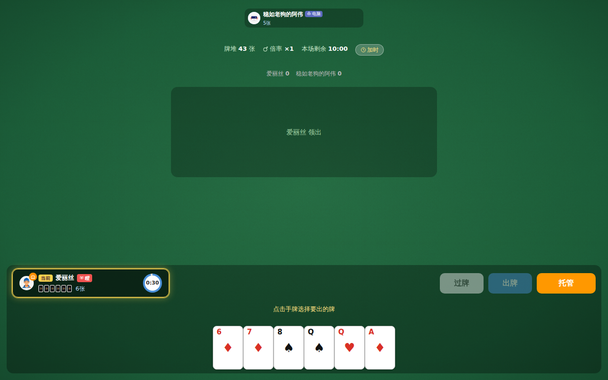

# Gan Deng Yan (干瞪眼 / look_at_it)

**English** · [简体中文](README.md)

LAN multiplayer [Gan Deng Yan](https://www.pagat.com/climbing/gandengyan.html) poker, **browser-only**: Node + Vue, no client to install. Account-based login (users are created by an agent / the admin page, no self-registration); game state is persisted, so refreshing, restarting the server or switching devices all resume the match.

## Highlights

- **2–8 players per table**: 2/3/4 wild cards (jokers) to choose from; 8 seconds of shuffling animation between hands, final standings when the session clock runs out, and the host can extend the session at any time
- **Bot players**: a fixed roster of 7 NPCs, added by the host with one click, **three difficulty levels (default: intermediate)** — beginners only play the smallest legal card, experts count cards
- **Auto-play & timeout moves**: hand your seat over to the server with one click; on timeout the engine passes or plays the smallest legal card
- **Reconnect-safe**: every action is written to the database, so a server restart restores rooms, games and the remaining session time
- **Mobile-ready**: two breakpoints (phone portrait / short landscape), the hand auto-fits, no horizontal overflow anywhere
- **`/admin` page**: create / delete accounts, view scores and room presence — fully isolated from game accounts

## Rules

- One deck + 2/3/4 wild cards (54/55/56 in total); rank order 3 (lowest) → A → 2 (highest); **a single 2 beats any single card, a pair of 2s beats any pair**
- To follow: same shape, same length, exactly one rank higher; runs need ≥3 cards, consecutive pairs ≥2 pairs, and **2 never enters a run or a sequence**
- **A wild cannot be played alone** (the exception: leading it as your last card = escape and instant win); it may complete pairs and bombs; two jokers are **not** a bomb
- A bomb (≥3 of a kind) beats any non-bomb; length beats rank; multiplier 2^(n-2), compounding within a hand
- If a round goes uncontested, the last player to act draws one card and leads the next round; the first player out of cards wins immediately
- Scoring: each loser pays cards left × accumulated multiplier × (2 if "shut out" : 1), the winner collects the sum — **always zero-sum**. "Shut out" (关瞪瞪) = you never played a single card that hand

> Gan Deng Yan has **no official rulebook**. The above are this repository's local rules — they agree with the common folk versions but make deliberate trade-offs; see "Origin and rule sources" below.

## Origin and rule sources

- **Origin**: the Chinese sources agree it began in **Sichuan** and later spread through Hubei and the rest of the country — said to have been invented by a group of bored players who agreed you may only "climb by one" (4 beaten only by 5). None of them gives a date.
- **Lineage**: a climbing game — same family as Zheng Shangyou, Da Lao Er and Dou Di Zhu — defined by the one-rank-only beat plus a tiny hand refilled after every trick.
- **Name**: 干瞪眼 is an ordinary Chinese idiom meaning "to watch helplessly, unable to do anything" (dictionary headword in 汉典, example: "seeing the crisp sweet peaches, one can only 干瞪眼"); the 2010 platform announcement calls it Sichuan dialect. **The game borrowed the word** — it is not named after the Lu Yao novel quote repeated by an English-language rules site.
- **Earliest written record found**: the 2010-09-29 launch announcement of the Chinese games platform 白金岛 (Baijindao) describes it as "a recently popular new way of playing, originating in Sichuan" — so the game is young, and already online-era from the start.
- **Where versions disagree** (and how this repo chose): two jokers a bomb (folk: yes — **here: no**), bomb size (3 of a kind or 4 — **here: ≥3**), hand size (dealer 7 / others 6, or 6 / 5 — **here 6 / 5**), players (2–4 or 2–6 — **here 2–8**). What the versions do agree on is the core: **2 is the highest rank and 2 never enters a run**, which is what this repository implements.
- **Legal note**: the encyclopedias flag that playing for money falls under the PRC Public Security Administration Punishments Law. This project keeps score only — no cash, no purchases, no wagering.

Sources: [快懂百科](https://www.baike.com/wikiid/8437297872339307926) · [百度百科](https://wapbaike.baidu.com/item/%E5%B9%B2%E7%9E%AA%E7%9C%BC/63808) · [搜狗百科](https://baike.sogou.com/v64557115.htm) · [汉典「干瞪眼」](https://www.zdic.net/hans/%E5%B9%B2%E7%9E%AA%E7%9C%BC) · [Pagat: Gan Deng Yan](https://www.pagat.com/climbing/gandengyan.html) · [白金岛公告 (2010-09-29)](http://52bjd.59w.com/news/349.html)

## Quick start

Hand the whole setup to a **harness tool** (an AI coding agent such as Claude Code) — give it the repository and say:

> Clone this repo, install dependencies, build and start the server, create a test account, then tell me the URL

It will run `npm install` → `npm run build` → start the server (port 3002 by default) → `npm run user -- add` to create the account, and hand you the URL; open it in a browser and play. Everything after that works the same way:

- **Development**: after editing `src/`, have it rebuild and refresh; changes under `server/` are picked up by tsx watch automatically
- **Tests**: have it run `npm test` (vitest: rules / state machine / snapshot privacy / 1000-hand fuzz / card counting / level 2·3 brains) and `npm run typecheck`
- **Accounts**: creating, password changes and deletion all go through the single entry point `npm run user` — **there is no self-registration**
- **Deployment**: tell it the target machine and port; syncing, building, starting the service and the health check (`GET /api/health`) are all it does. This repository keeps no manual deployment guide.

## Bots and difficulty

| Level | Brain | Behaviour |
|---|---|---|
| 1 Beginner | `basic` | minimal: play the smallest legal card |
| 2 Intermediate (**default**) | `smart` | + lead strategy and race blocking |
| 3 Expert | `expert` | + card counting to infer unseen cards |

The difficulty is chosen by the host when adding a bot and is bound to the seat (kept in memory; after a restart bots fall back to intermediate). Brain output is never trusted — every decision still goes through `applyPlay` / `applyPass` validation, with a legal fallback.

## Configuration

| Item | Notes |
|---|---|
| Port | `PORT` (3002 by default) |
| Database | `data/game.db` (SQLite, gitignored) |
| Session secret | `.secret` (generated automatically; **keep it** to stay logged in across restarts) |
| Admin password | `admin_password` in `.env` (gitignored — never commit it) |
| Room settings | wilds {2,3,4}, players [2,8], turn seconds [5,120], session minutes [1,60] |

Image asset specifications: [`docs/ASSETS.md`](docs/ASSETS.md) (Chinese).

## License

[MIT](LICENSE)
