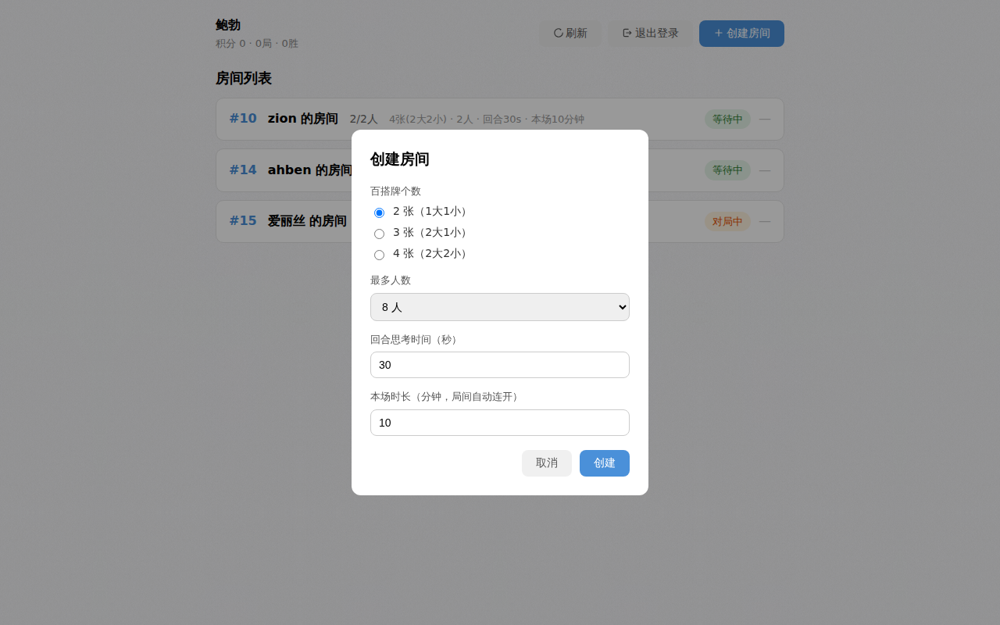

# 干瞪眼（look_at_it）

局域网多人干瞪眼：Node 后端 + Vue 前端，**纯浏览器**——无需安装客户端，浏览器打开即玩。
登录制（账号由脚本或管理页写入，**无自助注册**），对局状态落库，刷新 / 重启 / 换机重连均可恢复。


## 功能亮点

- **2~8 人同桌**：百搭 2/3/4 张可选，规则细节见下；一局 8 秒洗牌动画自动连开，本场时长（默认 10 分钟）耗尽后弹出总排名
- **电脑玩家**：固定 7 位 NPC（各有昵称人设），房主点「添加电脑」即可开局；**三档难度**（新手 / 普通 / 高手）添加时选定——高手会记牌推算
- **托管代打**：对局内一键托管，服务器 ~700ms 自动代打；回合超时自动过 / 自动出最小合法牌
- **本场加时**：房主随时 +15/30/45/60 分钟，进行中的对局不被到点打断；局末房主可「再来一局」或「解散房间」
- **断线恢复**：每个动作同步落库，服务器重启恢复房间 / 对局 / 剩余时间
- **移动端适配**：手机 / 横屏矮屏两档断点，手牌自适应铺满，全页面无横向溢出
- **管理页**：生成 / 删除账号、查看分数与在房状态（与游戏账号完全隔离）

## 玩法规则

- **1 副牌**（52 张自然牌）+ 百搭 **2/3/4 张可选**（2=1大1小、3=2大1小、4=2大2小，总牌数 54/55/56）
- 2~8 人/桌；牌序 3 最小 → A → 2 最大；**单2压任意单张、对2压任意对子**（炸弹除外）
- 跟牌：**同牌型、同长度、点数正好大 1**；顺子/连对 ≥3/≥2 组，**2 不入顺，A23 不算顺**
- **百搭不能单出**，唯一例外：领出且手中仅剩 1 张百搭（逃生即胜）；百搭可配对子/炸弹（含 2：2+王=对2、22+王=2炸）；**双王不是炸弹**
- 炸弹 ≥3 张同点：3张×2、4张(氢弹)×4、5张×8、6张×16（2^(n-2)），压任意非炸弹，张数优先于点数，**局内倍率累乘**
- 补牌：庄 6 闲 5，一轮无人接 → 最后出牌者补 1 张并领出；堆空继续打
- 先出完手牌立即获胜；**本场时间耗尽不打断进行中的对局**（桌面提示「时间已到 · 等待本局结束」），等当前局自然打完再结束本场
- 回合超时：跟牌自动过，领出自动出最小合法牌
- 计分：输家 = 剩牌 × 累计倍率 ×（关瞪瞪 ? 2 : 1），赢家收总和，**恒零和**

## 技术栈

- 后端：Node 24 + Express 5 + ws + `node:sqlite`（WAL），tsx 直跑 TS，**零其它运行时依赖**（scrypt/HMAC 用 node:crypto）
- 前端：Vue 3 + Vite + TS，单 `reactive()` store（无 router/pinia）
- 规则引擎 `src/game/`：纯函数、前后端共用一套规则与计分；vitest 157 用例（含 1000 局随机对局 fuzz + 全自动 fuzz：牌守恒 / 零和 / 必然终局）

## 快速开始

```bash
npm install

# 1. 建账号（唯一建号入口，无注册接口）
npm run user -- add <用户名> <密码> [昵称]
npm run user -- passwd <用户名> <新密码>

# 2. 开发/试玩：tsx watch 后端（默认 3002，托管 dist/）
npm run dev:server         # server/ 改动自动重启
npm run build              # 改了 src/ 前端后必须执行
# 浏览器打开 http://localhost:3002
```

常用命令：

```bash
npm test           # 规则引擎单测 + fuzz（157 用例）
npm run typecheck  # vue-tsc 全量类型检查
npm run build      # 产物到 dist/（服务端 express.static 托管）
npm start          # 无 watch 单进程形态（生产部署用，PORT 改端口）
```

## 电脑与大脑（NPC / BotBrain）

固定 7 位 NPC（`server/npc.ts`，启动时幂等补齐，不可登录），「添加电脑」只从花名册按序取空闲者；**难度在添加时由房主选择**（绑定座位，不写死在名册）：

| 账号 | 昵称 | 人设 |
|---|---|---|
| npc_1 | 稳如老狗的阿伟 | 沉稳稳健 |
| npc_2 | 出牌如风的小林 | 出牌果断 |
| npc_3 | 从不放水的陈姐 | 毫不留情 |
| npc_4 | 爱抢出牌的阿香 | 争强好胜 |
| npc_5 | 深藏不露的强哥 | 深沉狡黠 |
| npc_6 | 运气爆棚的老周 | 福星高照 |
| npc_7 | 总爱诈唬的小马 | 虚张声势 |

**难度分级**（房间页下拉「新手 / 普通 / 高手」）：

| 级别 | 大脑 | 智能 |
|---|---|---|
| 1 新手 | `basic` | 基础智能：领出最小单张、跟牌最小合法压牌，压不过过 |
| 2 普通 | `smart` | + 出牌策略（完胜优先、拆弱结构留对子/2/王、不乱炸、干净压牌）与竞跑拦截（威胁将出完时领最难压的牌/夺回领出，自己将完时加速甩牌） |
| 3 高手 | `expert` | + 记牌推算（公开已出牌计数 `seenRanks` → 估计未现牌：顶张优先甩、选拦截后最难被反压的牌、竞跑遇炸弹风险不喂顺子） |

难度为内存态，重启回 1 级。

**大脑抽象**（`src/game/brain.ts`）：每台电脑一把 `BotBrain { id, decide(ctx) }`；`ctx` 只含**公开信息 + 自己手牌**（`hand` / `prev` / `log` / `multiplier` / `handCounts` / `seat` / `wildCount` / `seenRanks`），返回 `{ cards, decl }`，跟牌态可返回 `null` 过牌（领出态返回 null 由引擎兜底出最小合法牌）。合法压牌的枚举唯一源是 `src/game/rules.ts` 的 `enumerateBeats`（`pickBeatingPlay` 是其首项薄包装），改压牌语义只动 rules 层。

**扩展新大脑**：

1. 新建 `src/game/brains/<id>.ts`，导出实现 `BotBrain` 的对象（可复用 `rules.ts` 与 `brains/strategy.ts` 的候选生成）；
2. 在 `src/game/brain.ts` 里 `import` 并 `registerBrain(<id>Brain)`；
3. 在 `server/npc.ts` 的 `BRAIN_ID_BY_LEVEL` 里挂上级别。

大脑输出**不受信**：仍经引擎校验，非法决策自动回退（跟牌→过牌、领出→最小合法牌），不会卡死对局。托管真人、未知 id 一律回退 `basic`。

## 管理页面（/admin）

- 打开 `http://<host>:<port>/admin`，输入 `.env` 里的 `admin_password` 登录（兼容 `admin_password: xxx` 与 `ADMIN_PASSWORD=xxx` 两种写法，环境变量 `ADMIN_PASSWORD` 优先）
- 功能：**生成账号**（用户名/密码/昵称）、**删除账号**（删除时踢掉其在线连接）、查看全部账号（分数/局数/胜场/电脑/在房状态）
- 删除保护：电脑账号不可删（保住历史与零和）；在房间中的玩家不可删
- 管理员**不参与游戏**：独立 `gdy_admin` 会话（2 小时），没有游戏账号、无法连接游戏 WS；管理登录独立限速

## 移动端适配

- 断点两档：**≤640px（手机竖屏）** 与 **≤500px（矮屏/横屏）**；桌面（>640px）布局不变
- 视口 `100dvh`（保留 `100vh` 回退）+ 安全区内边距；按钮/手牌 `touch-action: manipulation` 消除双击缩放
- **每个断点内尺寸恒定（零跳变）**：对手座位紧凑芯片、桌面区固定矮尺寸、操作按钮整行三等分；环形围桌小座位 250×40（昵称整行可读）
- 手牌 `ResizeObserver` 实测**自适应重叠**：任意张数恰好铺满可用宽度、相邻可见边可点；桌面 `n≤8` 不重叠
- 全部页面无横向溢出（弹窗 `max-width:94vw`、管理页表格容器内横向滚动）

## 图片素材

界面图片资源在 `public/`（Vite 原样拷入 `dist/`）：牌背 / 两张王牌 / 头像 / 绒布底纹 / 16 个 SVG 图标 / 结算横幅等。完整**素材规格表**（尺寸、宽高比、缺失降级表现、CSS mask 接入方式）见 [`docs/ASSETS.md`](docs/ASSETS.md)。

- 当前是占位素材，可由 `python3 temp/gen_placeholders.py`（Pillow）重新生成；正式素材**同名覆盖** `public/images/…` 即可，无需改代码
- 接入方式：牌背/纹理用 CSS 多重背景（图片缺失自动回退渐变），`` 全部挂 `@error` 隐藏兜底，徽标图标用 CSS mask（颜色继承文字色）

## 配置与数据



| 项 | 说明 |
|---|---|
| 端口 | 后端 `PORT`（默认 3002） |
| 数据库 | `data/game.db`（SQLite WAL，gitignore），`DB_PATH`/`DATA_DIR` 可覆写 |
| 会话密钥 | `.secret`（0600 自动生成，**保留它**跨重启维持登录；或用 `TOKEN_SECRET` 环境变量） |
| 管理密码 | `.env` 的 `admin_password`（gitignore，勿提交） |
| 房间配置 | 百搭 {2,3,4}、人数 [2,8]、回合秒 [5,120]、本场分钟 [1,60] |

## 部署

任意 Linux + Node 24 环境：

```bash
npm ci
npm run build
PORT=3002 npm start              # 单进程托管 dist/，健康检查 GET /api/health

# 首次部署建号（唯一入口，部署侧独立库）
npm run user -- add <用户名> <密码> [昵称]
```

- 同步代码到服务器时排除运行时状态：`node_modules/`、`data/`、`.secret`、`.env`、`temp/`、`*.log`——覆盖 `data/` 会清掉全部账号与对局历史，删除 `.secret` 会踢掉所有登录
- 纯 bot 房（无真人）在服务器启动时自动关闭，电脑回空闲池

## 安全与恢复

- 密码 scrypt 哈希；登录 token 为 HMAC-SHA256 自签，httpOnly cookie，TTL 7 天；登录按 IP 限速
- WebSocket upgrade 校验 cookie（失败 close 4001）；同账号新连接踢旧连接（close 4000）
- 服务器重启：恢复房间 / 对局与本场剩余时间（含局间洗牌倒计时、已结算的本场排名），过期回合补一步自动动作（不级联）；本场过期但对局进行中 → 等自然结束；版本不匹配的对局作废不计分
- 电脑账号只增不删（`users.is_bot`，不可登录）；移除仅脱离房间，保住对局历史与零和
- **解散房间**：仅房主 + 等待态；清房间成员并关房，成员回大厅，对局历史保留
- 公共快照绝不含手牌 / 牌堆内容（单测断言）；手牌只经私有消息下发

## 目录结构

```
├── scripts/user.ts        # 建号/改密 CLI
├── server/                # Express + ws：auth/db/users/roomManager/gameSession/restore
│   └── ws/                # hub（连接注册/踢旧/限速）+ dispatch（信封校验/消毒/路由）
├── src/
│   ├── types.ts           # 唯一类型源（含规则假设注释）
│   ├── game/              # 纯函数规则引擎（rules/combo/cards/engine/score + brains/）+ __tests__
│   ├── net/               # WS 客户端（指数退避重连）+ fetch 封装
│   ├── store.ts / App.vue # 全局状态 + phase 视图切换（login/boot/lobby/room/game）
│   ├── views/             # Login / Lobby / Room / Game
│   └── components/        # 手牌/座位/桌面/声明弹窗/结算等
├── docs/                  # README 截图
└── data/                  # 运行时 SQLite（gitignore）
```

## 测试

```bash
npm test    # vitest 157 用例
```

覆盖：规则边界（百搭/2/顺子/炸弹/计分）+ 引擎状态机（含超时自动步）+ 快照隐私（公共状态绝不泄露手牌/牌堆）+ 1000 局随机对局 fuzz + 全自动对局 fuzz（牌守恒/零和/必然终局）+ 记牌计数 + 2/3 级大脑启发式。项目另配套一批 Playwright 浏览器 E2E 与 WS 集成脚本（本地 `temp/` 目录，未入库），覆盖环形牌桌布局稳定性、移动端矩阵、托管/难度/加时/解散等场景。

## 许可证

[MIT](LICENSE)
