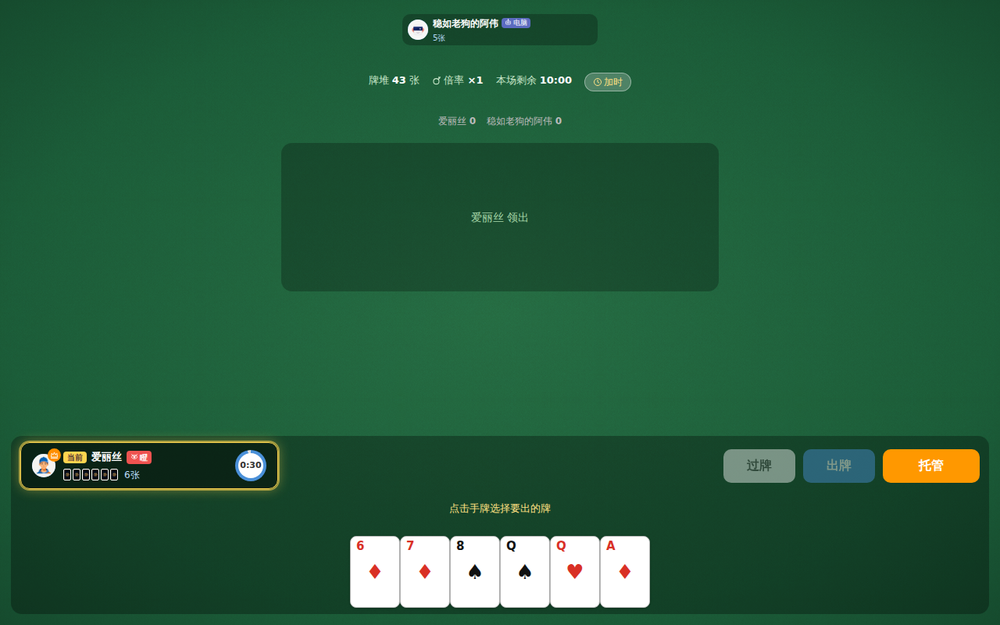

# 干瞪眼（Gan Deng Yan / look_at_it）

**简体中文** · [English](README.en.md)

局域网多人干瞪眼（Gan Deng Yan）扑克，**纯浏览器**：Node + Vue 实现，打开即玩、无需装客户端。登录制（账号由 agent/管理页写入，无自助注册），对局状态落库，刷新 / 重启 / 换机重连均可恢复。

## 功能亮点

- **2~8 人同桌**：百搭 2/3/4 张可选；一局结束 8 秒洗牌自动连开，本场时长耗尽弹出总排名，房主可随时加时
- **电脑玩家**：7 位固定 NPC，房主一键添加，**三档难度默认「普通」**——新手只出最小合法牌，高手会记牌推算
- **托管与自动步**：对局内一键托管由服务器代打；回合超时自动过 / 自动出最小合法牌
- **断线恢复**：每个动作同步落库，服务器重启恢复房间 / 对局 / 本场剩余时间
- **移动端适配**：手机竖屏 / 横屏矮屏两档断点，手牌自适应铺满，全页面无横向溢出
- **管理页 `/admin`**：生成 / 删除账号、查看分数与在房状态，与游戏账号完全隔离

## 玩法规则

- 1 副牌 + 百搭 2/3/4 张（总牌 54/55/56）；牌序 3 最小 → A → 2 最大，**单 2 压任意单张、对 2 压任意对子**
- 跟牌：同牌型、同长度、点数大 1；顺子 ≥3 张、连对 ≥2 对，**2 不入顺**
- **百搭不能单出**（领出且仅剩 1 张百搭可出 = 逃生即胜）；可配对子 / 炸弹，双王不是炸弹
- 炸弹 ≥3 张同点压任意非炸弹，张数优先于点数，倍率 2^(n-2) 局内累乘
- 一轮无人接 → 最后出牌者补 1 张并领出；先出完手牌立即获胜
- 计分：输家 = 剩牌 × 累计倍率 ×（关瞪瞪 ? 2 : 1），赢家收总和，**恒零和**（「关瞪瞪」＝整局未出一张牌，与结算弹窗提示同源）

> 干瞪眼**没有统一官方规则**：上面是本仓库采用的**本地规则**，与常见民间版一致但有取舍，出处与差异见下节。

## 渊源与规则出处

- **起源**：民间通说**起源于四川**（后流行于四川、湖北乃至全国），由「一群玩牌嫌无聊的玩家」约定只能「挨着出」而来；中文百科均未给出确切年代。
- **谱系**：属于**压牌 / 爬梯类**（climbing games）——与升级、斗地主、打大A 同族，特色是「**同牌型、点数正好大一级**才能压」＋小手牌每轮补牌。
- **名称**：「干瞪眼」本身是既有汉语俗语（汉典释义「干着急而没有办法」），平台公告则称其为**四川方言**——牌戏**借词命名**；英文规则站 Pagat 把名字系于路遥《平凡的世界》引文，属二次附会，**不宜作为词源引用**。
- **成文时间**：目前可查较早的成文记录是棋牌平台《白金岛》**2010-09-29** 上线公告（该版三张为普通牌型、四张才是炸弹、双王为最大炸弹，与今天各民间版仍有出入）；Pagat 记录的是**云南文山版**，其 2020-05 写作时判断「规则仍在演化，尚无标准版」。
- **主要分歧点**（本仓库的取舍）：双王是否为炸弹（**否**）、牌序方向（本项目 **3 最小 → A → 2 最大**）、起手张数与发牌方向（各地不一）、三张算炸弹还是「飞机」（本项目算**炸弹**）。
- **法规提示**：百科条目注明——**一旦涉及金钱交易即受《治安管理处罚法》约束**；本仓库仅供娱乐计分，不含任何现金 / 赌博功能。

参考：[快懂百科](https://www.baike.com/wikiid/8437297872339307926) · [百度百科](https://wapbaike.baidu.com/item/%E5%B9%B2%E7%9E%AA%E7%9C%BC/63808) · [搜狗百科](https://baike.sogou.com/v64557115.htm) · [汉典「干瞪眼」](https://www.zdic.net/hans/%E5%B9%B2%E7%9E%AA%E7%9C%BC) · [Pagat: Gan Deng Yan](https://www.pagat.com/climbing/gandengyan.html) · [白金岛公告（2010-09-29）](http://52bjd.59w.com/news/349.html)

英文文档见 [`README.en.md`](README.en.md)。

## 快速开始

整个上手流程交给 **harness 工具**（AI 编码代理，如 Claude Code）完成——把仓库给它，说一句：

> 克隆这个仓库，装好依赖、构建并启动，建一个测试账号，然后把访问地址告诉我

它会依次执行 `npm install` → `npm run build` → 启动服务（默认 3002）→ `npm run user -- add` 建号，最后把地址交给你，浏览器打开即玩。后续一切同样只需吩咐：

- **开发**：改完 `src/` 让它构建再刷新；`server/` 改动由 tsx watch 自动重启
- **测试**：让它跑 `npm test`（157 用例：规则 / 状态机 / 快照隐私 / fuzz / 记牌 / 2·3 级大脑）与 `npm run typecheck`
- **账号**：建号 / 改密 / 删除直接吩咐——唯一建号入口 `npm run user`，**无自助注册**
- **部署**：告诉它目标机器与端口，同步、构建、启动与健康检查（`GET /api/health`）由它完成；本仓库不维护手工部署手册

## 电脑与难度

| 级别 | 大脑 | 智能 |
|---|---|---|
| 1 新手 | `basic` | 基础：最小合法压牌 |
| 2 普通（**默认**） | `smart` | + 出牌策略与竞跑拦截 |
| 3 高手 | `expert` | + 记牌推算未现牌 |

难度由房主添加时选定、绑定座位（内存态，重启后回退中级）；大脑输出不受信，均经引擎校验兜底。

## 配置

| 项 | 说明 |
|---|---|
| 端口 | `PORT`（默认 3002） |
| 数据库 | `data/game.db`（SQLite，gitignore） |
| 会话密钥 | `.secret`（自动生成，**保留**可跨重启维持登录） |
| 管理密码 | `.env` 的 `admin_password`（gitignore，勿提交） |
| 房间配置 | 百搭 {2,3,4}、人数 [2,8]、回合秒 [5,120]、本场分钟 [1,60] |

图片素材规格见 [`docs/ASSETS.md`](docs/ASSETS.md)。

## 许可证

[MIT](LICENSE)
